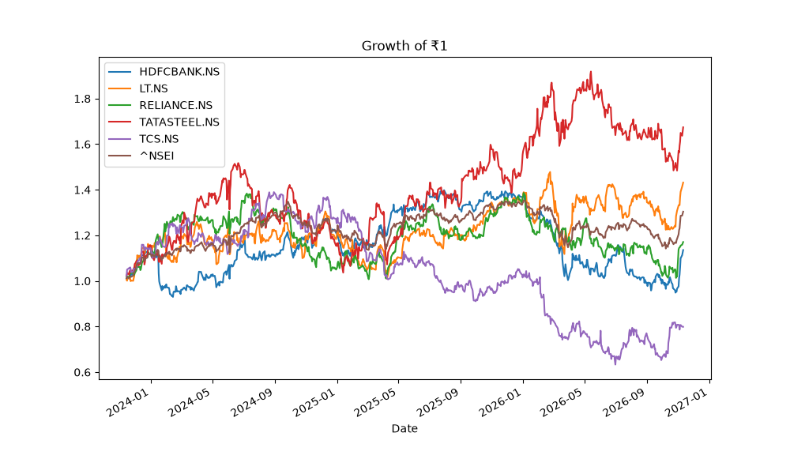
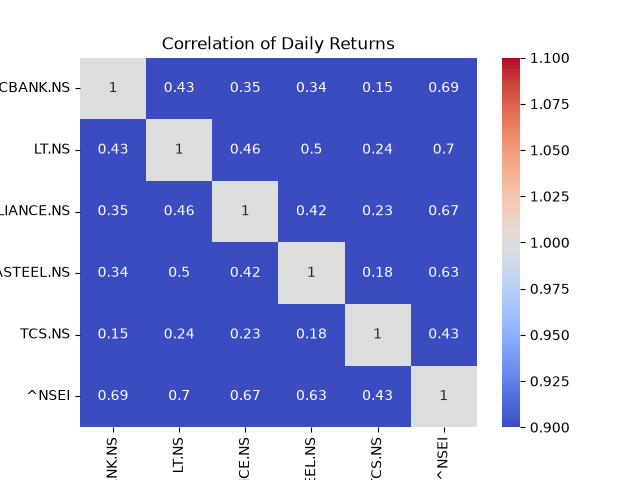
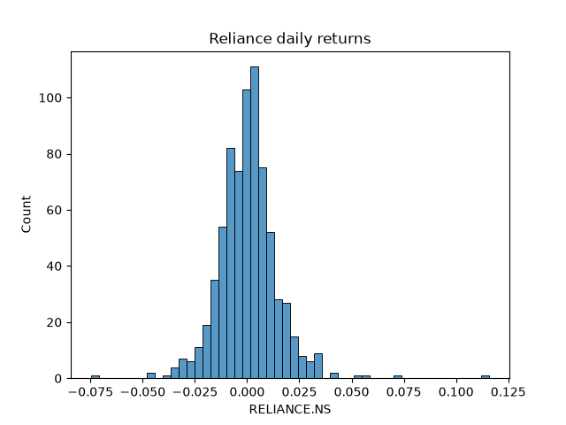

# Portfolio vs Nifty 50: Risk, Return & Diversification Analysis

An analysis of an equal-weight portfolio of five large Indian companies (HDFC Bank, L&T, Reliance Industries, Tata Steel, TCS) against the Nifty 50, using about three years of daily data.

- **Period:** 13 Nov 2023 to 11 Nov 2026
- **Benchmark:** Nifty 50 (`^NSEI`)
- **Portfolio:** equal weight (20% each), averaged daily
- **Tools:** Python, pandas, matplotlib, seaborn, yfinance

## Questions

1. How do the five stocks compare on return and risk?
2. How much risk does combining them remove (the diversification effect)?
3. Did the basket beat simply buying the index?

## Results at a glance

| Asset | Annual return | Annual volatility | Return/Risk |
|---|---:|---:|---:|
| Tata Steel | 21.6% | 28.2% | 0.77 |
| L&T | 15.6% | 25.7% | 0.61 |
| Reliance | 7.9% | 22.4% | 0.35 |
| HDFC Bank | 6.5% | 20.9% | 0.31 |
| TCS | -4.7% | 24.4% | -0.19 |
| **Average of the 5 stocks** | 9.4% | 24.3% | 0.39 |
| **Equal-weight portfolio** | 9.4% | 16.7% | 0.56 |
| **Nifty 50** | 10.0% | 13.6% | 0.74 |



## Key findings

### 1. Tata Steel had the highest return and the highest risk

Tata Steel returned 21.6% a year with 28.2% volatility, the highest of both. Its Return/Risk ratio (0.77) was also the best of the five, so in this period the extra risk was rewarded. High volatility does not automatically mean poor risk-adjusted performance.

### 2. Only Tata Steel and L&T beat the Nifty

Tata Steel (21.6%) and L&T (15.6%) beat the Nifty's 10.0%. Reliance (7.9%), HDFC Bank (6.5%) and TCS (-4.7%) did not. Because the portfolio is an equal-weight average, its 9.4% return is exactly the average of the five stock returns, so the two winners were diluted by the three laggards.

### 3. TCS was the least tied to the market, and lost money

TCS had the lowest correlation with the Nifty (0.43, against 0.63 to 0.70 for the others) and the only negative return (-4.7%). A low correlation helps diversification but does not make a stock a good holding by itself.

### 4. Tata Steel and L&T moved together most

Their daily returns had the highest pairwise correlation among the five stocks (0.50). Both are tied to industrial and infrastructure activity, which may explain it, though the correlation alone does not prove the cause. The lowest pair was HDFC Bank and TCS (0.15), a bank and an IT exporter.



### 5. Diversification and concentration

**Diversification effect.** If all five stocks moved perfectly together, the equal-weight portfolio would have the average of their volatilities, about 24.3%. With the actual correlations (average pairwise correlation 0.33) its volatility was 16.7%, about **31% lower**. That gap is what combining imperfectly correlated stocks removed.

**Concentration versus the index.** The Nifty is itself a diversified basket of 50 stocks. The five-stock portfolio was still about 22% more volatile than the index (16.7% vs 13.6%). This is a statement about breadth: five stocks cannot match the diversification of fifty, even though they captured much of the benefit available to them.

### 6. The portfolio did not beat the index

Compared with the Nifty, the portfolio earned slightly less (9.4% vs 10.0%) with more volatility (16.7% vs 13.6%), so its return per unit of risk was lower (0.56 vs 0.74). The index was the better choice in this window. Diversification lowers risk; it does not guarantee outperformance.



## Data and cleaning

- Prices for the five stocks and the Nifty were downloaded with yfinance (3 years of daily Close prices, 739 trading days).
- One day, 2026-01-15, had no Nifty value while all the stocks did. The row was dropped so every series stays aligned on the same dates.
- Returns were computed with `pct_change()`, which removes the first day, leaving 737 daily observations.
- Extreme days were checked and kept because they match real events: L&T fell 12.7% on 2024-06-04, the day of the general election results, and Reliance rose 11.6% on 2026-11-02, a day with volume several times normal. Removing them would understate risk.

## Methodology

1. Download daily prices and clean missing values.
2. Compute daily percentage returns.
3. Annualized return = mean daily return x 252.
4. Annualized volatility = standard deviation of daily returns x square root of 252.
5. Build the portfolio as the daily average of the five stocks' returns.
6. Compute the correlation matrix of daily returns.
7. Compare portfolio volatility with the average of its stocks' volatilities (diversification effect) and with the Nifty (concentration and benchmark comparison).

## Limitations

- **Short window.** About three years may not cover different market cycles, and the extreme days have a large effect.
- **Hand-picked stocks.** The five companies were chosen by me, with an industrial lean (L&T, Tata Steel), so the findings apply to this basket only.
- **Simplified portfolio.** Equal weights with daily rebalancing; real investors rebalance less often, which changes results.
- **Simple annualization.** Returns use mean x 252, not compounded annual growth.
- **Volatility as the only risk measure.** Drawdowns, downside risk and liquidity are not captured.
- **Return/Risk is not a Sharpe ratio.** No risk-free rate is deducted.
- **Price data.** Returns are based on yfinance Close prices, and dividends may not be fully reflected depending on the adjustment settings used.
- **Historical data.** Past returns and correlations do not guarantee future behaviour, and correlations tend to rise in market stress.

## How to run

```
pip install pandas numpy matplotlib seaborn yfinance
python step1_download.py     # downloads prices and saves prices.csv
python step2_returns.py      # cleans data and computes daily returns
python step3_analysis.py     # statistics, correlations and charts
```

## Files

- `5shwhat1.py`, `5shwhat2.py`, `5shwhat3.py`: the analysis scripts
- `cumulative_returns.png`, `correlation_heatmap.png`, `reliance_hist.png`: charts
- `portfolio_vs_nifty.xlsx`: summary tables and key comparisons

## Conclusion

Picking stocks on high historical returns is not the same as building a good portfolio. Tata Steel gave the best return with the highest risk, and TCS gave low correlation but negative returns. Combining the five stocks cut volatility by about 31% compared with holding them separately, which shows the diversification effect, but the portfolio still earned less than the Nifty with more risk, which shows the limits of a five-stock basket. Diversification reduces risk, but it does not by itself deliver better risk-adjusted returns.
